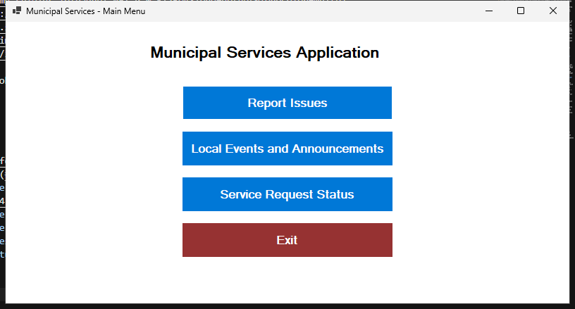
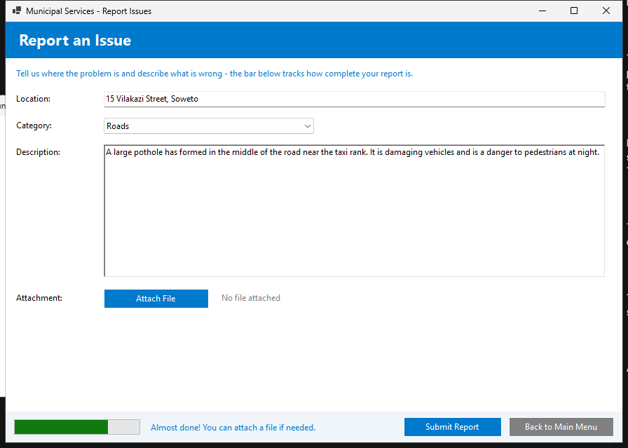
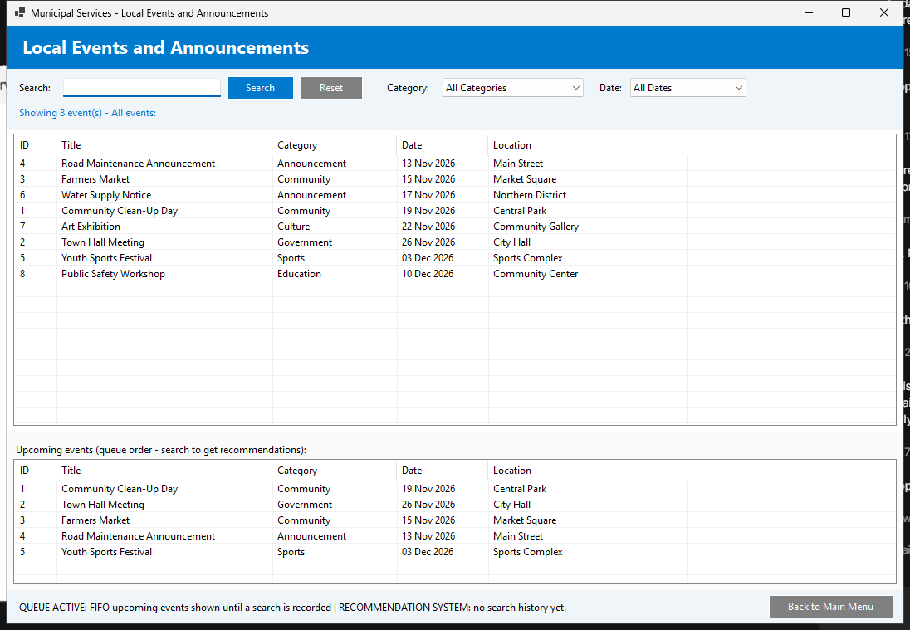
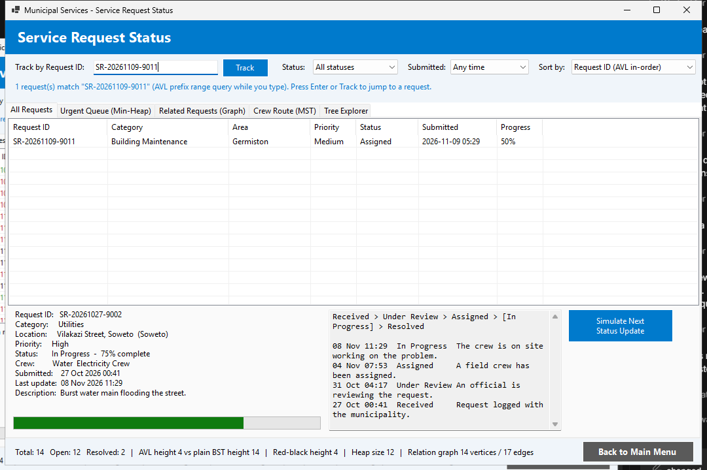
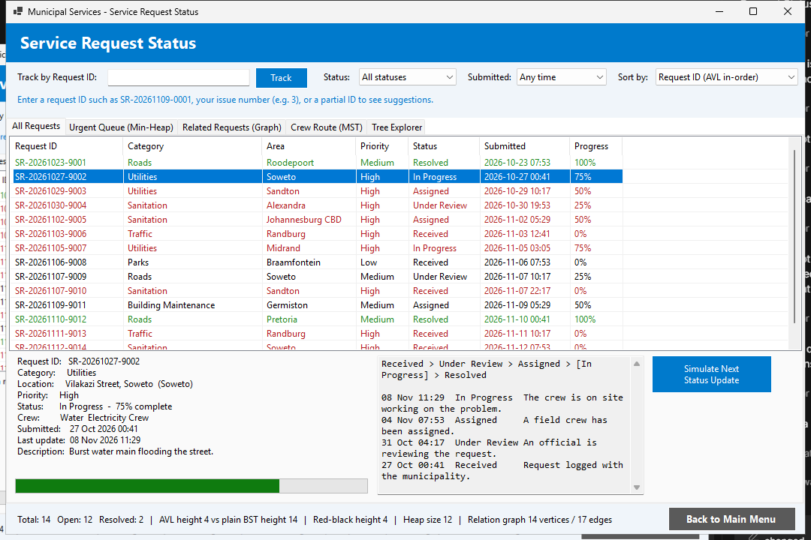
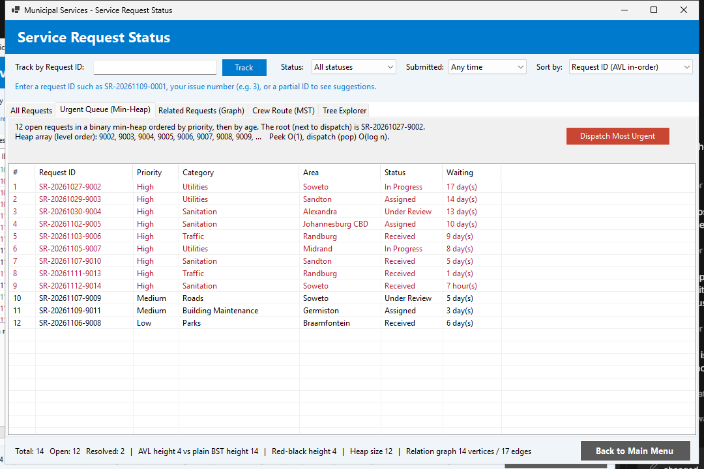
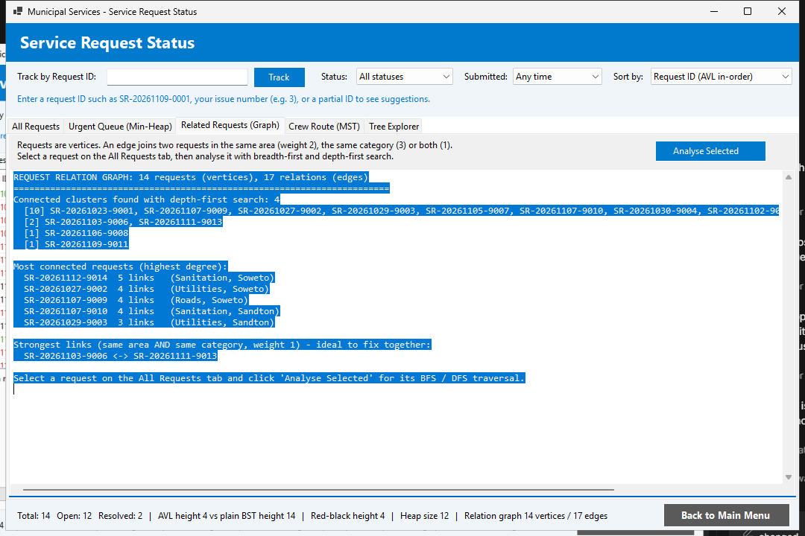
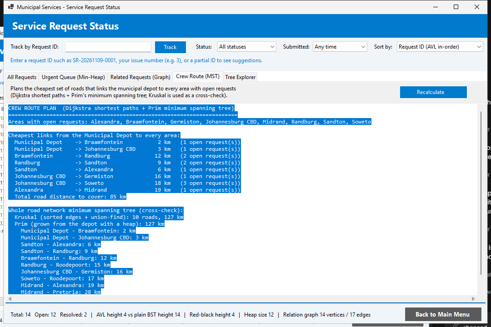
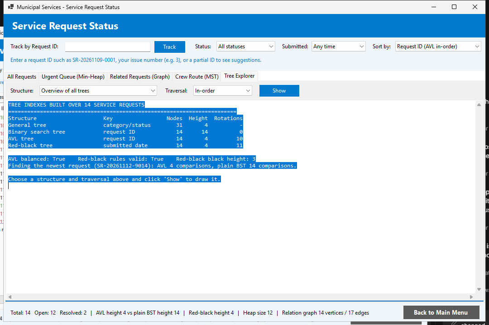

# Municipal Services Application

### POE Part 3 — Final Submission

A C# Windows Forms application for South African residents to **report service delivery issues** (Part 1), **find local events and announcements** (Part 2), and **track their service requests** (Part 3). The Service Request Status feature is built entirely on hand-written trees, a heap, and graphs — no built-in collections are used for the indexes.


**Student:** Lindokuhle Zwane · **Student No:** ST10381088 · **Module:** AAPD7112

---

## Contents

1. [Features](#1-features)
2. [Requirements](#2-requirements)
3. [How to Compile](#3-how-to-compile)
4. [How to Run](#4-how-to-run)
5. [How to Run the Unit Tests](#5-how-to-run-the-unit-tests)
6. [How to Use the Application](#6-how-to-use-the-application)
7. [Data Structures and Their Role](#7-data-structures-and-their-role)
8. [Project Structure](#8-project-structure)
9. [Screenshots](#screenshots)

---

## 1. Features

| Module | Highlights |
|---|---|
| **Report Issues** | Location, category, rich description, file attachments via `OpenFileDialog`, engagement progress bar, JSON persistence |
| **Local Events & Announcements** | Live search filtering, category/date filters (backed by dictionary and `SortedDictionary` indexes), recently-viewed stack, upcoming-events queue, search-pattern recommendations |
| **Service Request Status** | Track by unique ID or issue number, live prefix filtering, status/date/sort filters, urgent min-heap dispatch, graph analysis (BFS/DFS), Dijkstra routing, Prim & Kruskal MST crew routes, full Tree Explorer |

---

## 2. Requirements

| Item | Version |
|---|---|
| Operating system | Windows 10 or 11 |
| SDK | .NET 9.0 SDK (`net9.0-windows`) |
| IDE (optional) | Visual Studio 2022 17.12 or later, with the ".NET desktop development" workload |

The application needs no database or internet connection. Issues and events are saved to `issues_data.json` and `events_data.json` next to the executable. The test project downloads xUnit from NuGet the first time it is restored.

## 3. How to Compile

**Visual Studio:** open `MunicipalServicesApp.sln` and press **Ctrl+Shift+B**.

**Command line** (from the project folder):

```powershell
dotnet build MunicipalServicesApp.csproj -c Release
```

The output is `bin\Release\net9.0-windows\MunicipalServicesApp.exe`.

## 4. How to Run

- **Visual Studio:** press **F5**.
- **Command line:** `dotnet run --project MunicipalServicesApp.csproj`
- **Directly:** double-click `bin\Release\net9.0-windows\MunicipalServicesApp.exe`.

## 5. How to Run the Unit Tests

```powershell
dotnet test Tests\MunicipalServicesApp.Tests
```

The 32 xUnit tests cover every tree, the heap, the graph algorithms, the service request repository, the Part 1 integration and the Part 2 search-history fix. The tested code has no Windows Forms dependency, so the tests also run on Linux or macOS.

## 6. How to Use the Application

### Main Menu

The menu has four buttons: **Report Issues**, **Local Events and Announcements**, **Service Request Status** and **Exit**. Each module opens as a dialog and returns to the menu when it is closed.

### Report Issues (Part 1)

1. Enter the **location** (for example "15 Vilakazi Street, Soweto"), choose a **category**, type a **description** and optionally **attach** a file. The progress bar and messages guide you.
2. Click **Submit**. The confirmation shows the **Issue ID** (for example `3`) and the **Service Request ID** (for example `SR-20261109-0003`). Both numbers work for tracking on the Service Request Status page.

### Local Events and Announcements (Part 2)

- Filter by category or date, or type in the search box. Results filter while you type, but only clicking **Search** is saved to your search history.
- Selecting an event records it as recently viewed (stack) and shows the view order in the status line.
- The **Recommendations** list is built from your most frequent searches and from high-priority events; before your first search it shows the upcoming-events queue.

### Service Request Status (Part 3)

| Tab / control | What it does |
|---|---|
| **Track by Request ID** | Type a request ID (`SR-20261109-0003`), your issue number (`3`) or part of an ID (`SR-202611`) — the list filters as you type. Press Enter or **Track** to select the request, see its status pop-up, and read how many comparisons the AVL tree, the plain BST and a linear scan needed. |
| **Status / Submitted / Sort by** | Filter by status or by submission period (last 24 hours, 3, 7 or 30 days). Sort by ID (AVL), newest first (red-black) or urgency (min-heap). |
| **All Requests** | Colour-coded list (red = high-priority open, green = resolved). Select a row to see the details, progress bar, status pipeline and timeline. **Simulate Next Status Update** moves it through Received > Under Review > Assigned > In Progress > Resolved. For your own issues, the new status is saved to `issues_data.json`. |
| **Urgent Queue (Min-Heap)** | Open requests by priority, then age, plus the heap array. **Dispatch Most Urgent** takes the root of the heap and advances it. |
| **Related Requests (Graph)** | Graph overview (clusters, most connected requests, strongest links). **Analyse Selected** runs breadth-first search (hops) and depth-first search (cluster order) and suggests requests to batch on the same visit. |
| **Crew Route (MST)** | The cheapest set of roads that links the municipal depot to every area with open requests, with Kruskal and Prim run on the whole road network as a cross-check. |
| **Tree Explorer** | A table of every tree index (nodes, height, rotations). You can draw any tree (general, BST, AVL, red-black) with an in-, pre-, post- or level-order traversal. |

The page starts with 14 demo requests (`SR-yyyyMMdd-90xx`) in Gauteng areas, plus every issue you have reported. The area is detected from the location text (for example "Soweto" or "Sandton"), and the priority comes from the category.

## 7. Data Structures and Their Role

The trees, heap and graph are hand-written in `DataStructures/`. `Services/ServiceRequestRepository.cs` keeps them in step: after every change it rebuilds all indexes from one master list, so they never disagree.

| Structure | File | Role in Service Request Status | Efficiency |
|---|---|---|---|
| **Basic (general) tree** | `GeneralTree.cs` | Groups requests as Root > Category > Status > Request for the Tree Explorer overview (31 nodes, 4 levels with the demo data). | Build O(n), any number of children |
| **Binary tree / Binary search tree** | `BinaryTrees.cs` (`BinarySearchTree`) | Index by request ID, kept unbalanced on purpose as a baseline. IDs start with the date and arrive in date order, so it becomes a chain (height 14 for the 14 demo requests). | O(h): O(log n) for random keys, O(n) for sorted keys |
| **AVL tree** | `BinaryTrees.cs` (`AvlTree`) | Main index for **tracking by unique ID**, the ID-sorted list and partial-ID search. The same 14 IDs give height 4 (10 rotations). | O(log n) search/insert, height < 1.44 log2 n |
| **Red-black tree** | `BinaryTrees.cs` (`RedBlackTree`) | Index by **submission date** (key `yyyyMMddHHmmss\|ID`). Gives the newest-first list and the **Submitted** filter through `Range(low, high)`. | O(log n) insert, range O(log n + k), height ≤ 2 log2(n+1) |
| **Min-heap** | `MinHeap.cs` | **Urgent queue**: highest priority first, then oldest. It is also the priority queue inside Dijkstra and Prim. | Peek O(1), push/pop O(log n), heapify O(n) |
| **Graph** | `WeightedGraph.cs` | (a) Relation graph: requests are vertices, joined when they share an area or category (14 vertices, 17 edges, 4 clusters with the demo data). (b) Road network of 11 areas with distances in km. | Adjacency list, O(V + E) memory |
| **Graph traversal (BFS, DFS)** | `WeightedGraph.cs` | BFS gives the hop distance to related requests. DFS gives the order of a whole cluster and the connected components. | O(V + E) |
| **Dijkstra** | `WeightedGraph.cs` | Real road distances between the areas with open requests. | O((V + E) log V) |
| **Minimum spanning tree (Prim, Kruskal)** | `WeightedGraph.cs` | Cheapest roads joining the depot to every open area (85 km with the demo data). Kruskal and union-find on the whole network give the same 127 km as Prim. | Prim O(E log V), Kruskal O(E log E) |

### Examples

- **Tracking:** the newest demo request takes 4 comparisons in the AVL tree and 14 in the plain BST. With 10 000 requests, the AVL tree would need about 14 comparisons and a chained BST up to 10 000.
- **Date filter:** "Last 7 days" returns 7 of the 14 demo requests after visiting 10 red-black nodes, because subtrees outside the period are skipped.
- **Urgency:** a high-priority Utilities request reported today is dispatched before a low-priority Parks request from last week, because the heap compares priority first and age second.
- **Relationships:** analysing a Soweto request lists the other Soweto requests and the requests in the same category one hop away (BFS), so one crew trip can handle them together.
- **Crew route:** Prim links eight areas with 85 km of road. For example, Depot > Braamfontein > Randburg > Sandton > Alexandra > Midrand, and Depot > Johannesburg CBD > Soweto and Germiston.

`PROJECT_REPORT.md` (section 3) explains each structure in depth.

## 8. Project Structure

```
MunicipalServicesApp/
├── MunicipalServicesApp.sln            # solution (app + tests)
├── Program.cs, Form1.cs                # entry point and main menu
├── ReportIssuesForm.cs                 # Part 1
├── LocalEventsForm.cs                  # Part 2
├── ServiceRequestStatusForm.cs         # Part 3 (5 tabs, built in code)
├── Models/                             # Issue (+ JSON storage), Event + EventManager, ServiceRequest
├── Services/ServiceRequestRepository.cs  # owns requests and every index structure
├── DataStructures/                     # GeneralTree, BinaryTrees (BST/AVL/RB), MinHeap, WeightedGraph
├── Tests/MunicipalServicesApp.Tests/   # 32 xUnit tests
└── PROJECT_REPORT.md                   # completion report + technology recommendations + feedback updates
```

---

## Screenshots

### Main Menu


### Report Issues


### Local Events and Announcements


### Service Request Status

**Track by Request ID** — live AVL prefix filtering while typing:



**All Requests** — request list with details, status pipeline, timeline and progress:



**Urgent Queue (Min-Heap)** — open requests ordered by priority, then age:



**Related Requests (Graph)** — relation graph, clusters, most connected requests:



**Crew Route (MST)** — cheapest roads linking the depot to all open areas (Dijkstra + Prim + Kruskal):



**Tree Explorer** — every tree index (nodes, height, rotations) with traversals:



---

<sub>Municipal Services Application · POE Parts 1–3 · Lindokuhle Zwane (ST10381088) · AAPD7112</sub>
